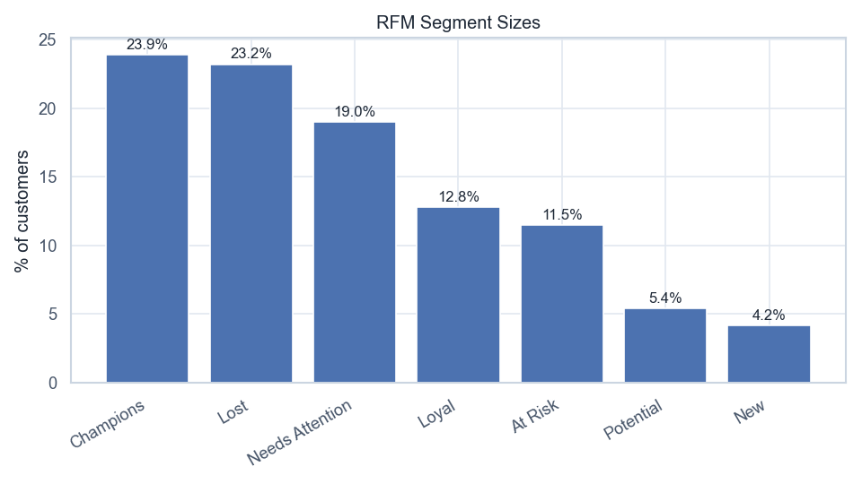

# Volta — RFM Analysis

[](https://github.com/NikitaBoyarkin/case-rfm/actions/workflows/ci.yml)

[](LICENSE)

R/F/M scoring 1–5 splits the base into lifecycle segments from Champions to Lost; recency and monetary diverge — 'frequent but cheap' and 'rare but large'.

## Key results

- 7 lifecycle segments (Champions→Lost)
- Champions — 23.9% of the base with high R/F/M
- Different profiles need different campaigns

## Situation

We need a simple, interpretable customer-value layer complementing cluster segmentation.

## Task

I needed a value layer that stays simple and interpretable, so I owned adding it as a complement to the cluster segmentation.

## Actions

- R/F/M quintile scoring → lifecycle tiers.
- Heatmap of mean R/F/M by segment.

## Result

- R/F/M scoring splits the base into lifecycle segments from **Champions** to **Lost**.
- **Champions (23.9%)** hold all three axes high (R 91, F 93, M 93); **New** has high R (100) but low F/M (~30–35).
- **At Risk (11.5%)** and **Lost (23.2%)** are a large reactivation reserve.

## Recommendations

- Champions/Loyal — upsell and defend; At Risk/Lost — reactivate.
- Don't apply one offer to all RFM profiles.
- Tie RFM tiers to the win-back economics (Project 22).

## Charts




## Dataset

The dataset is fully synthetic, generated by seeded, reproducible script(s) (`scripts/generate_rfm_data.py`). No real customer data is used. Running `make data` regenerates the CSV(s) in `data/` with the same random seed, so every number below is reproducible.

## Quick start

```bash
uv sync --all-groups
make data
make run
```

## Project structure

```text
case-rfm/
├── README.md
├── LICENSE
├── .gitignore
├── .python-version
├── pyproject.toml
├── Makefile
├── .github/workflows/ci.yml
├── scripts/
│   ├── generate_rfm_data.py
│   └── volta_rfm_analysis.py
├── utils/
│   ├── __init__.py
│   ├── common.py
│   └── viz_helpers.py
├── data/
│   └── volta_rfm_transactions.csv
├── outputs/
│   ├── rfm_heatmap.png
│   ├── rfm_segment_sizes.png
└── tests/
    └── test_rfm.py
```

## Stack

- Python
- pandas / NumPy
- SciPy / Statsmodels
- scikit-learn
- Matplotlib / Seaborn
- uv + ruff

## Links

- [Full case study on the portfolio site](https://nikitaboyarkin.github.io/en/projects/volta/rfm/)
- [Parent project — volta-banking](https://github.com/NikitaBoyarkin/volta-banking)
